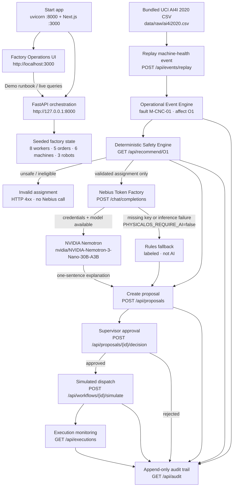

# Seeknimbly PhysicalOS

Supervisor console for simulated factory work. A public machine-health table can raise an exception, the safety engine picks an eligible worker, machine, and robot, and a person approves before any simulated dispatch. An optional Nebius-hosted NVIDIA model may explain that assignment. It does not approve it and it does not move equipment.

## End-to-end data flow

What happens when you start the app and run the primary demo (Factory Operations → Demo runbook):



**Safety boundary:** Nebius Nemotron explains a validated recommendation. It cannot change resource IDs, invent certifications, approve work, or command equipment. Simulated adapters only.

## Run

```bash
python -m venv .venv
.venv\Scripts\pip install -r requirements.txt
.venv\Scripts\uvicorn api.index:app --host 127.0.0.1 --port 8000
```

```bash
cd frontend
npm install
npm run dev
```

| Surface | URL |
|---------|-----|
| Factory Operations UI | http://localhost:3000 |
| API | http://127.0.0.1:8000 |
| Health | http://127.0.0.1:8000/api/health |
| Inference probe | http://127.0.0.1:8000/api/inference/test |

Tests: `.venv\Scripts\python -m pytest -q` and, in `frontend/`, `npm run test` · `npm run test:e2e`.

Copy `.env.example` to `.env` when you have a Nebius Token Factory key. Required model id: `nvidia/NVIDIA-Nemotron-3-Nano-30B-A3B`. Base URL: `https://api.tokenfactory.us-central1.nebius.com/v1`. Without a key, recommendations use a deterministic rules fallback and say so.

## What is implemented

- Eight synthetic workers, five work orders, six simulated machines, three simulated robots.
- Replay of the bundled UCI AI4I 2020 CSV (`data/raw/ai4i2020.csv`, 10,000 rows). A `Machine failure = 1` row faults simulated machine `M-CNC-01` and affects work order `O1`. Dataset UDIs are not machine ids. UCI describes this dataset as synthetic.
- Deterministic eligibility, supervisor approve/reject, duplicate-decision rejection, simulated adapters, and an audit log.
- Next.js Factory Operations console: dashboard, factory floor, work orders, workforce, machines, robots, AI orchestration, approvals, executions, datasets, audit, and settings.

## What is not claimed

- Live Nebius inference requires `NEBIUS_API_KEY` and `NEBIUS_MODEL`. Without them, `/api/inference/test` returns 503 and explanations stay on the labeled rules fallback.
- No Vercel deploy is implied by this README.
- No physical robot, PLC, or ROS 2 command path is active.
- SQLite on a serverless disk is ephemeral.

## Docs

- [Architecture](docs/ARCHITECTURE.md)
- [Data provenance](docs/DATA_PROVENANCE.md)
- [Demo guide](docs/DEMO_GUIDE.md)
- [Deployment](docs/DEPLOYMENT.md)
- [Security](docs/SECURITY.md)
- [Hackathon draft](docs/HACKATHON_SUBMISSION.md) — not submitted

MIT license. See [LICENSE](LICENSE).
