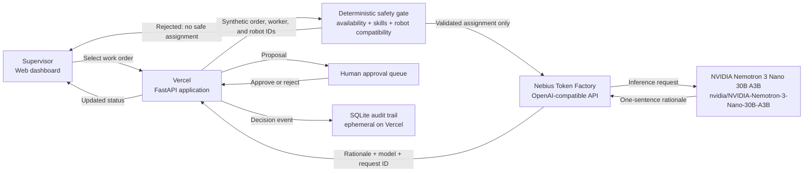

# Seeknimbly PhysicalOS

Human-approved manufacturing dispatch for workers, work orders, and simulated robots—with deterministic safety checks, auditable decisions, and optional NVIDIA model inference hosted by Nebius Token Factory.


> Hackathon status: the workflow is verified locally and on Vercel. Production inference was verified on October 30, 2026 through Nebius Token Factory using `nvidia/NVIDIA-Nemotron-3-Nano-30B-A3B`.

## Workflow and data flow



The model is downstream of the deterministic safety gate: it explains an assignment that the application has already validated. It cannot change worker eligibility, bypass compatibility checks, approve its own proposal, or control physical machinery. The live verification endpoint is [`/api/inference/test`](https://seeknimbly-physicalos.vercel.app/api/inference/test).

## What it demonstrates

- Eight synthetic workers, five work orders, and three simulated robots.
- Deterministic availability, qualification, and robot-compatibility checks.
- A supervisor approval/rejection queue and SQLite audit trail.
- A clear safety boundary: model output explains an eligible assignment; it never overrides safety checks or controls real machinery.
- An OpenAI-compatible Nebius Token Factory adapter with model and request provenance.

## Run locally

```bash
python -m venv .venv
.venv/Scripts/pip install -r requirements.txt
.venv/Scripts/uvicorn api.index:app --reload
```

Open `http://127.0.0.1:8000`. Run tests with `.venv/Scripts/pytest -q`.

## Configure Nebius-hosted NVIDIA inference

1. Copy `.env.example` to `.env`.
2. Set `NEBIUS_API_KEY` to a Token Factory key.
3. Set `NEBIUS_MODEL=nvidia/NVIDIA-Nemotron-3-Nano-30B-A3B`, the NVIDIA model verified for this deployment.
4. Set `NEBIUS_BASE_URL=https://api.tokenfactory.us-central1.nebius.com/v1`.
5. Start the app with those variables loaded.
6. Open `/api/inference/test`. A qualifying check returns `verified: true`, the exact model, provider, rationale, and inference request ID supplied by Token Factory.
7. Confirm `/api/recommend/O1` reports `source: nebius_token_factory`.

`PHYSICALOS_REQUIRE_AI=true` makes recommendation calls fail closed if inference fails. Without it, the demo remains usable in clearly labeled rules mode.

## Deploy to Vercel

```bash
vercel
vercel env add NEBIUS_API_KEY production
vercel env add NEBIUS_MODEL production
vercel --prod
```

Vercel's filesystem is ephemeral; the SQLite queue is suitable for a short demo, not production persistence.

## Hackathon fit

Recommended category: **Best Apps and Agents**. The software acts on a manufacturing workflow, while the “robots” are explicitly simulated. The Physical AI track adds a one-minute hardware/module-footage obligation and is less defensible without physical hardware.

For the Nebius × NVIDIA Global AI Hackathon, the final entry also needs a public repository, public working demo, public YouTube video under three minutes, truthful model/platform feedback, and an explanation of significant changes since August 26, 2026.

## Significant updates during the submission period

The project extends an earlier synthetic factory concept. During the submission period it gained a standalone FastAPI workflow, deterministic worker/robot validation, supervisor approval, audit logging, Vercel packaging, automated tests, and a Nebius Token Factory adapter designed to call an eligible NVIDIA open-source model without exposing credentials.

## Limitations and non-claims

- All factory data and robots are simulated.
- No PLC, machine, payroll, or employment system is controlled.
- The current Vercel persistence layer is ephemeral.
- Passing tests alone do not prove a Nebius inference call; the live `/api/inference/test` response provides that evidence.
- The verified integration generates dispatch explanations only; it does not perform safety decisions or robot control.

MIT licensed. See [LICENSE](LICENSE).

