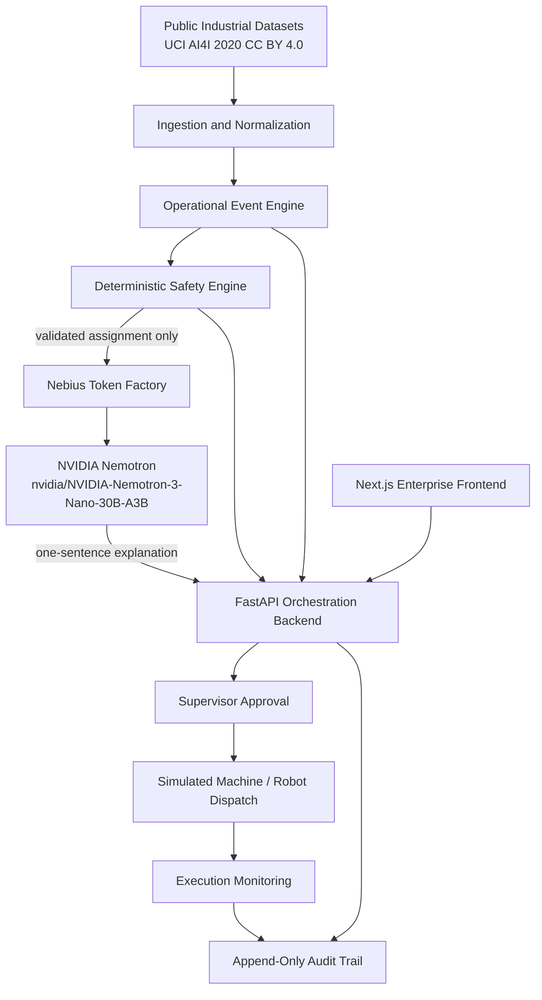

# Architecture — Seeknimbly PhysicalOS

## Product boundary

PhysicalOS is a **simulation-only** manufacturing orchestration control plane for the Nebius × NVIDIA hackathon. It coordinates synthetic workers, machines, and robots. It never commands physical equipment.

**Critical safety boundary:** Nebius-hosted NVIDIA Nemotron **explains** assignments that the deterministic safety engine has already validated. The model cannot authorize execution, alter resource IDs, invent certifications, or override eligibility rules. A human supervisor must approve before simulated dispatch.

## System diagram



## Runtime components

| Layer | Tech | Responsibility |
|-------|------|----------------|
| Frontend | Next.js App Router, React, TypeScript, Tailwind, TanStack Query, React Flow | Command Center, orchestration, approvals, datasets, audit |
| Backend | FastAPI + Pydantic | Authoritative safety, workflows, Nebius adapter, APIs |
| Persistence | SQLite (`PHYSICALOS_DB`) | Proposals, workflows, executions, audit |
| Inference | Nebius Token Factory OpenAI-compatible `/chat/completions` | Explanation only |
| Data | `data/raw/ai4i2020.csv` | Machine-health event replay |

## Workflow state machine

```text
EVENT_DETECTED → CONTEXT_RESOLVED → SAFETY_VALIDATED → AI_EXPLAINED
→ APPROVAL_PENDING → APPROVED → SIMULATED_DISPATCH → RUNNING → COMPLETED
```

Alternate terminals: `VALIDATION_FAILED`, `REJECTED`, `EXPIRED`, `EXECUTION_FAILED`, `CANCELLED`, `ESCALATED`.

`PHYSICALOS_REQUIRE_AI=false` allows advancing with an explicitly labeled **deterministic rules fallback** when Nebius credentials are absent or inference fails. Fallback responses are never labeled as AI-generated.

## Package layout

```text
api/index.py                 # Vercel/uvicorn entry (re-exports app)
backend/app/
  main.py                    # HTTP routes
  core/                      # config, auth
  db/                        # SQLite schema
  services/                  # safety, events, workflows, audit, seed
  integrations/
    nebius.py
    datasets/ai4i.py
    robotics/adapters.py
frontend/                    # Next.js enterprise UI
data/raw/ai4i2020.csv
docs/
tests/
```

## Tie-breaking rules (deterministic)

1. Workers: ascending numeric `id` among available, skill- and certification-qualified, not double-booked.
2. Machines: preferred machine for the order first, then ascending `id`; exclude fault/maintenance/offline.
3. Robots: ascending `id` among available robots matching required type/capability.

## Deployment sketch (not auto-deployed)

- Frontend: Vercel (Next.js)
- Backend: FastAPI on Python host or Vercel Python function via `api/index.py`
- Durable PostgreSQL recommended for shared hosted state; local/demo uses SQLite

Do not deploy without explicit operator approval.
