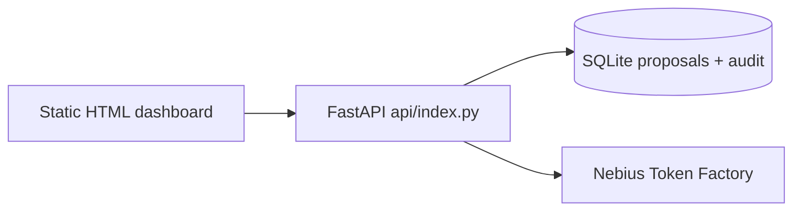

# Baseline Audit — Seeknimbly PhysicalOS

**Audit date:** 2026-10-30  
**Auditor:** Autonomous engineering agent  
**Repository root:** `seeknimbly-physicalos-main/` (nested zip layout)

## Existing architecture

The repository is a compact FastAPI monolith packaged for Vercel:

| Path | Role |
|------|------|
| `api/index.py` | FastAPI app: synthetic factory state, eligibility, Nebius adapter, proposals, audit |
| `api/index.html` | Single-page HTML/JS supervisor dashboard |
| `tests/test_app.py` | 12 pytest cases covering health, recommend, proposals, audit |
| `vercel.json` | Rewrites all traffic to `/api/index/$1` |
| `requirements.txt` | fastapi, uvicorn, httpx, pytest |
| `.env.example` | Nebius key/model/base URL + `PHYSICALOS_REQUIRE_AI` |
| `README.md`, `DEMO_SCRIPT.md`, `devpost-submission.md`, `LICENSE` | Hackathon packaging |

There is **no** Next.js, React, TypeScript, SQLAlchemy migrations, machines entity, public dataset ingestion, workflow state machine, or simulated execution adapters.



## Working features (verified)

| Feature | Evidence |
|---------|----------|
| Homepage HTML served | `GET /` returns PhysicalOS markup |
| Health endpoint | `GET /api/health` |
| Synthetic state | 8 workers, 5 orders, 3 robots via `GET /api/state` |
| Deterministic eligibility | First available skilled worker + matching robot type |
| Rules-mode recommendation | `source: rules` when Nebius credentials absent |
| Tampered proposal rejection | Worker ID mismatch → 400 |
| Proposal create / approve / reject | SQLite-backed with duplicate-decision → 409 |
| Audit trail | `proposal_created`, `proposal_approved` / `proposal_rejected` |
| Inference credential gate | `GET /api/inference/test` → 503 without keys |
| Vercel path rewrite middleware | Strips `/api/index` prefix |
| MIT license and demo docs | Present |

## Test results (pre-refactor)

```text
Command: .venv/Scripts/python -m pytest -q
Result:  12 passed, 1 warning in 3.35s
Warning: Starlette TestClient BlockingPortal deprecation (dependency)
Date:    2026-10-30
```

## Broken / incomplete relative to master prompt

| Gap | Severity |
|-----|----------|
| No enterprise Next.js frontend / design system | Critical for demo UX |
| No machines model or machine-health events | Critical for primary demo |
| No public industrial dataset ingestion | Critical |
| No workflow state machine / simulated dispatch execution | Critical |
| Safety checks incomplete (no certs, double-book, machine state, dependencies, expiry) | High |
| Nebius default base URL uses legacy host (`api.tokenfactory.nebius.com`) vs required `us-central1` URL | High |
| No auth / demo token on mutating routes | High |
| No robots/machines/datasets/workflows/executions API surface | High |
| In-memory fixtures mutate poorly across requests; no seed/reset | Medium |
| SQLite ephemeral on Vercel (documented) | Medium / known |
| README claims production inference verified — cannot be re-verified here without credentials | Honesty gap |
| No frontend lint/typecheck/Playwright suite | High for acceptance |

## Missing requirements (by part)

- Parts 4–7, 18–20, 22: enterprise UI, Command Center, factory floor, orchestration, executions
- Parts 8–9: open data provenance + richer synthetic factory (machines, certs, deadlines)
- Parts 10–15: unified model, full safety engine, workflow engine, simulation adapters
- Parts 17 (new routes), 21 (richer audit), 24–27 (expanded tests/docs)

## Security concerns

1. Mutating endpoints (`POST /api/proposals*`) are unauthenticated.
2. Nebius key is server-side only (good); ensure no `NEXT_PUBLIC_` leakage when frontend is added.
3. CORS not configured (fine for same-origin HTML; needed for separate Next.js origin).
4. SQLite file path writable under `/tmp` on Vercel — acceptable for demo, not multi-tenant safe.
5. Error paths may surface exception class names to clients (`502 Nebius inference failed: …`).

## Recommended changes (shortest path to E2E demo)

1. **Preserve** existing routes and pytest contracts; expand behind them.
2. **Modularize** into `backend/app/` with `api/index.py` re-exporting `app` for Vercel.
3. **Seed** machines + richer workers/orders; map AI4I failure rows → machine-health events.
4. **Download** UCI AI4I 2020 CSV (CC BY 4.0) into `data/raw/` and document provenance.
5. **Implement** safety engine → Nebius explanation → approval → simulated dispatch → audit.
6. **Add** demo admin token for mutating/demo routes.
7. **Build** Next.js App Router frontend consuming typed APIs; keep FastAPI authoritative for safety.
8. **Update** `.env.example` to required Nebius URL/model defaults.
9. **Expand** pytest + add Vitest/Playwright for the primary demo path.
10. **Do not deploy or submit** without explicit user approval.

## Assets worth preserving

- Eligibility-before-AI pattern in `_eligible` / `_nebius_explanation`
- Proposal tamper check against deterministic eligibility
- Duplicate decision prevention
- Append-only audit inserts
- Vercel rewrite middleware
- Existing test names and assertions (extend, do not casually delete)

## Environment notes (no secret values printed)

- Python available: 3.13.7 (prompt prefers 3.12; use 3.13 locally with pinned deps)
- Node: v24.13.0 / npm 11.7.0
- `.env` not present in workspace at audit time
- Dataset download attempted during Phase 0: see `docs/DATA_PROVENANCE.md` after ingestion step
